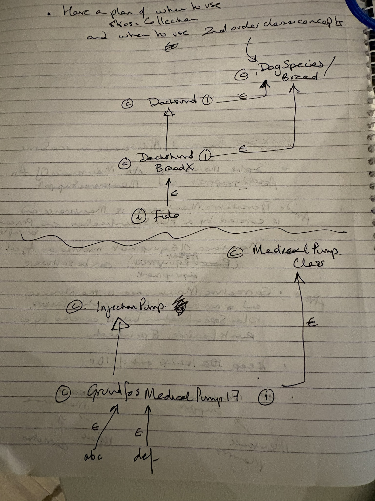

# To do list following meetings with Johan Kluwer 18/10/26

## Modular architecture design

- skos version of iso14224 modules (clause 3, Appendix A, Appendix B)
- skos version of SMRP metrics
- stand alone maintenance ontology module
- maintenance work order ontology module
- bridge ontology between modules and ido
- use case data
- keep 14224 out of the new maintenance ontology

## Maintenance ontology

- make standalone maintenance ontology untethered from IDO 
Replace MaintenanceActivity with Maintenance
- See figures in the Carapace files 18.10.26 in \images
- Split Maintenance into MaintenanceOnEquipment and MaintenanceSupport
- MaintenanceOnEquipment involves an agent (a piece of equipment)
- Maintenance planning is part of MaintenanceSupport
- Consider restrictions such as PreventativeMaintenance has as input a PlanSpecification. It can be planned or unplanned. Corrective maintenance is not covered by a PlanSpecification but can be done as part of a run-to-failure strategy
- consider if we are including software maintenance

## 14224

- make as skos only
- make L6 and L7 skos:Collection

## Modelling reminders

- Check all members of a skos:Collection are skos:Concepts
- skos:Collection is a skos:Concept
- Have rules on when to use skos:Collection and when to use 2nd order class concepts.
- when choosing names for skos:Collection put an 's' at the end is good practice but don't do this for owl:Class
- avoid creating bespoke data and object properties in skos vocabularies

## 2nd class modelling concepts

- 2nd order classes have 1st order classes as members (individuals)

- for example we can then say owl:class ex:DogSpecies owl:disjointWith owl:class ex:CatSpecies. Cannot say this with skos:Collection

